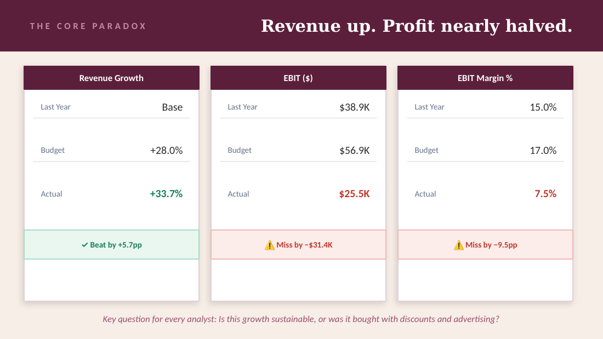

# Beauty Brand Portfolio — P&L Analysis, KPI Tracker and What-If Model

**Question:** Revenue beat budget. So why did EBIT miss by $31K?

**Answer in one line:** Most of the extra sales were given away in discounts, and three cost lines ran over budget at the same time: selling (+$12.7K), advertising & promotion (+$10.5K) and store operations (+$9.2K). Revenue grew 33.7% against a 28% plan, yet EBIT margin fell to 7.5% against a 17.0% budget.

## Data

- **Source:** P&L dataset provided for a course assignment (Last Year / Budget / Actual)
- **Scope:** 6 brands × 5 sales channels × 13 P&L lines = 390 rows
- **Brands:** MAC, Estée Lauder, Clinique, Tom Ford, The Ordinary, Jo Malone London
- **Channels:** Free Standing stores, Online third-party platforms (3PP), Brand.com, Department Stores, Specialty Multi-brand

## What I built

**Excel workbook** (`Beauty_Portfolio_KPI_Tracker.xlsx`). Every figure is calculated with `SUMIF` / `SUMIFS` from the raw data, so changing the data updates the whole workbook.

| Sheet | Contents |
|---|---|
| `Raw_Data` | Source P&L, 390 rows |
| `📊 KPI Dashboard` | 5 KPIs vs last year, budget and target, with status and trend flags |
| `📉 EBIT Bridge` | Budget EBIT → actual EBIT, line by line (also vs last year), plus a driver chart; ties back to the dashboard |
| `🎯 Scenario Manager` | Pessimistic / base / optimistic scenarios; the base case reproduces the actual P&L |
| `🎯 Goal Seek & What-If` | Gross sales needed for a target EBIT margin; a sensitivity table of discount rate × advertising intensity |
| `⚙️ Decision Maker` | Weighted scorecards for brands and channels; EBIT recovery plan with calculated uplift |

**Presentation** (`Beauty_Portfolio_DA_Insights.pptx`): 9 slides with 5 insights, an A/B testing and validation plan, and next steps.

## KPIs

| KPI | Formula | Last year | Budget | Actual | vs budget |
|---|---|---|---|---|---|
| EBIT margin | EBIT ÷ Net sales | 15.0% | 17.0% | **7.5%** | −9.5 pp ❌ |
| Gross profit margin | Gross profit ÷ Net sales | 68.6% | 66.6% | 66.4% | −0.3 pp |
| Discount rate | Discounts ÷ Gross sales | 28.6% | 28.0% | 29.8% | +1.8 pp ⚠️ |
| Advertising intensity | (Advertising + Promotion) ÷ Net sales | 11.6% | 14.1% | **17.0%** | +2.9 pp ⚠️ |
| Revenue growth | Gross sales vs last year | — | +28.0% | +33.7% | +5.7 pp ✅ |

## Where the $31K went (actual vs budget)

| Driver | Effect on EBIT |
|---|---|
| Extra gross sales | +$22.2K |
| Higher discounts | −$15.7K |
| Returns, bonification, cost of goods | −$4.4K |
| Selling costs | −$12.7K |
| Advertising & promotion | −$10.5K |
| Store operating costs | −$9.2K |
| Marketing, shipping, shared services | −$1.1K |
| **Total** | **−$31.4K** |

## Key findings

1. **Growth didn't reach the bottom line.** Gross sales were $22.2K above budget, but only $4.6K of that remained after discounts and returns. EBIT came in at $25.5K against a $56.9K budget.
2. **Three cost lines ran over budget.** Selling costs were +$12.7K, mostly in Specialty Multi, Free Standing and Department Stores. Ad & promo was +$10.5K, driven by Online 3PP (+$12.0K, partly offset by underspend elsewhere). Store costs were +$9.2K, mostly in Free Standing. Compared with last year, ad & promo nearly doubled (+92%).
3. **Two channels lose money.** Specialty Multi has an EBIT margin of −24.4% and the lowest gross margin (44.7%). Department Stores has an EBIT margin of −3.6%. Brand.com is the most profitable channel (31.5%) but the smallest ($53K gross sales).
4. **The brands are polarised.** The Ordinary is the standout, with +284% growth and a 21.2% EBIT margin. Clinique (−6.5%) and Jo Malone London (−10.0%) are loss-making despite healthy gross margins.
5. **Growth alone won't fix margin.** At current margins and costs, a 15% EBIT margin would need +22% gross sales ($629K). Even capping ads at 13% and cutting discounts to 26% only reaches about 13.8%, so cost action is needed too.

## Recommendations

| Action | Est. EBIT uplift |
|---|---|
| Cap ad + promo at 13% of net sales | +$13.5K |
| Cut discount rate to 27% of gross sales (volume held) | +$14.5K |
| Exit or renegotiate Specialty Multi | +$11.0K |
| Shift budget to Brand.com; fix Clinique / Jo Malone cost base | estimates; see workbook |

The uplifts overlap, so they shouldn't be added together. Each should be validated with the A/B tests described in the deck before rollout.

## Tools

Excel (`SUMIF`/`SUMIFS` modelling, scenario and sensitivity analysis, conditional formatting) · PowerPoint

## Files

- `Beauty_Portfolio_KPI_Tracker.xlsx` — formula-driven workbook
- `Beauty_Portfolio_DA_Insights.pptx` / [`.pdf`](Beauty_Portfolio_DA_Insights.pdf) — insights deck
- `deck_preview.png` — preview image
